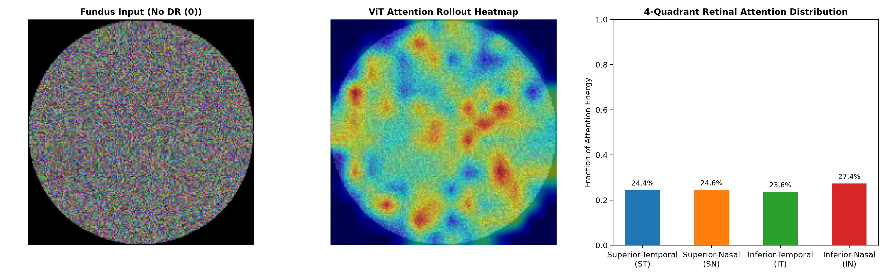

# Clinical Screening Report: vit_small_patch16_224

## 1. Experimental Configuration
- **Model**: `vit_small_patch16_224`
- **Regime**: `top_blocks`
- **Epochs**: `5`
- **Device**: `cpu`
- **Training Duration**: `138.7s`

## 2. Clinical Evaluation Metrics
| Metric | Result | Clinical Gold Standard Target |
|:---|:---:|:---:|
| **Quadratic Weighted Kappa (QWK)** | **-0.0060** | > 0.85 (Human Specialist Concordance) |
| **Macro-F1 Score** | **0.0941** | Balanced across all 5 DR grades |
| **Referable DR Sensitivity (Grade >= 2)** | **60.00%** | > 85.0% (WHO Tele-screening guideline) |
| **Referable DR Specificity (Grade >= 2)** | **31.82%** | > 80.0% (Minimizing false hospital referrals) |
| **Expected Calibration Error (ECE)** | **0.0550** | < 0.050 (High clinical confidence calibration) |

## 3. Explainability: 4-Quadrant Saliency Distribution
| Quadrant | Saliency Energy Share | Clinical Meaning |
|:---|:---:|:---|
| **Superior-Temporal (ST)** | 24.4% | Superotemporal arcades / macular boundary |
| **Superior-Nasal (SN)** | 24.6% | Superior optic disc nasal vessels |
| **Inferior-Temporal (IT)** | 23.6% | Inferotemporal arcades (common neovascularization site) |
| **Inferior-Nasal (IN)** | 27.4% | Inferonasal retina |

